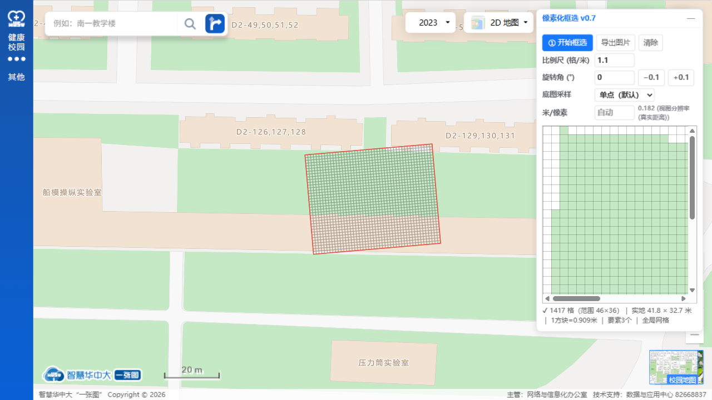
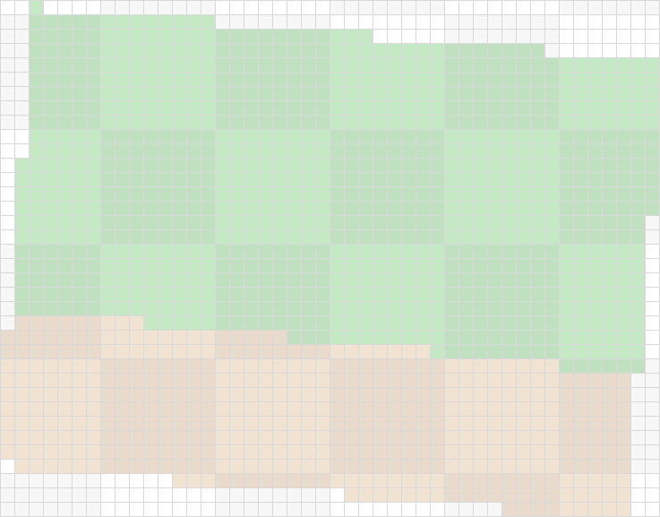
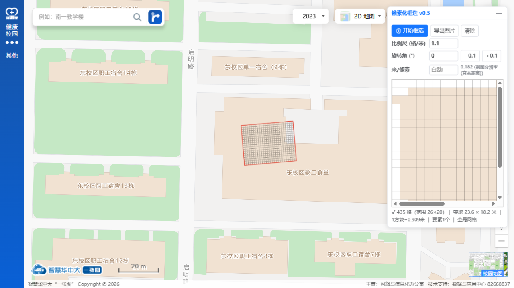
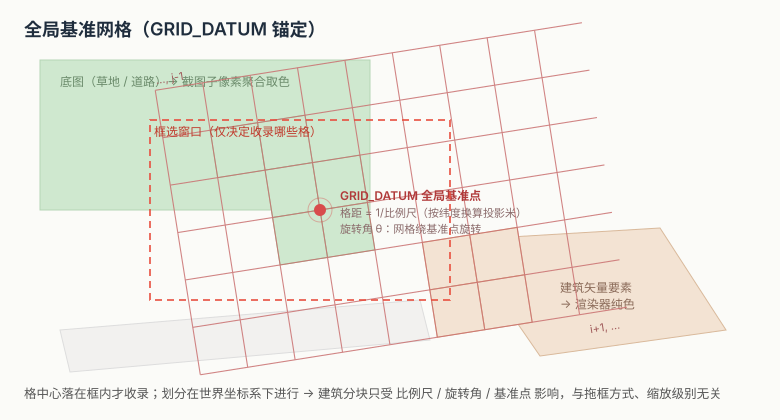

# hust-map-pixelizer

**华中科技大学校园地图 · 像素化框选工具** —— 为校园 Minecraft 还原工程打造的 Tampermonkey 用户脚本。

在 [智慧华中大一张图](https://map.hust.edu.cn/OneMap/Home/OneMap)（ArcGIS JS API）上拖拽框选，即刻得到按可配置**比例尺**与**旋转角**划分的 Minecraft 方块网格像素化视图。颜色优先取自地图矢量要素（建筑层渲染器纯色），底图走截图聚合采样；导出 PNG 按 **15px/方块 + 1px 网格线 + 8×8 棋盘底纹**绘制，可直接数格、按格施工。

  

## 界面与效果

| 框选采样（面板 + 覆盖层） | 导出图片（8×8 棋盘底纹） |
|---|---|
|  |  |

像素网格与建筑严格贴合（覆盖层锚定全局网格，平移缩放不漂移）：



## 功能特性

- **拖拽框选**：开启框选后在地图上拖出选区，自动采样并渲染像素网格覆盖层 + 面板预览
- **全局基准网格**：划分锚定固定基准点（`GRID_DATUM`），同一建筑的分块与配色**只受比例尺、旋转角影响**，与谁拖框、框的偏差、缩放级别无关 → 多人分工导出的图可按全局格坐标直接拼贴
- **矢量优先取色**：建筑格命中「华中大二维建筑物」要素层取渲染器纯色（多数表决，边缘不渗色）；底图（草地/道路/水系）4 种聚合方式可选
- **文字标注过滤**：自动剔除烙在底图瓦片里的地名文字像素，不产生灰色杂色
- **比例尺换算**：自动按纬度校正 WebMercator 投影变形，与地图自带比例尺/测距工具同口径（默认 1 实地米 = 1.1 方块）
- **PNG 导出**：15px/方块 + 1px 网格线 + 8×8 棋盘底纹（暗格叠 3% 黑，便于按 8 计数），文件名自带格数与单位换算
- **配置持久化**：比例尺 / 旋转角 / 采样方式存 localStorage，刷新页面不丢

## 安装

1. 浏览器安装 [Tampermonkey](https://www.tampermonkey.net/) 扩展
2. 点击 Tampermonkey 图标 → 添加新脚本 → 粘贴 [`hust-map-pixelizer.user.js`](hust-map-pixelizer.user.js) 全文并保存
   （或下载文件后拖入浏览器，由 Tampermonkey 引导安装）
3. 登录 [校园地图](https://map.hust.edu.cn/OneMap/Home/OneMap)（需校园账号，脚本不接触账号凭据），右上角出现「像素化框选」面板即安装成功

> 更新脚本时请**整文件替换**：网格基准点写死在脚本内，全团队版本不一致会导致各人导出的像素图无法对齐。

## 使用

1. 滚轮放大地图到建筑级别（建议每格 ≥ 4 屏幕像素，状态栏有提示）
2. 点「① 开始框选」→ 在地图上拖出选区 → 出结果；`Esc` 退出框选
3. 调整比例尺 / 旋转角 / 采样方式 → 选区**即时重算**
4. 点「导出图片」获取 PNG；「清除」清空结果；面板标题栏可拖动，「—」可折叠

### 配置参数

| 参数 | 默认 | 说明 |
|---|---|---|
| 比例尺 (格/米) | `1.1` | 1 实地米 = 1.1 方块，即 1 方块 ≈ 0.909 m |
| 旋转角 (°) | `0` | 网格绕全局基准点旋转，±0.1° 步进；校园建筑多为正南北向，通常无需调整 |
| 底图采样 | `众数` | `单点` 保真最快；`均值` 平滑但产生大量中间色；`中位数` / `众数` 色彩最"平"，贴合 MC 方块观感 |
| 米/像素 | 自动 | 自动取视图分辨率（纬度校正）；也可用地图内置测距工具量已知距离后手动校准 |

## 工作原理

```
拖拽框选（窗口）
   │  世界网格裁剪：格中心落在框内才收录（确定性判定）
   ▼
要素查询 queryFeatures ──┐
底图截图 takeScreenshot ─┤   （并行）
   ▼                     ▼
逐格采样：建筑 3×3 多数表决 → 渲染器纯色
          其余 → 底图 3×3 子像素聚合（众数/中位数/均值/单点，剔除文字像素）
   ▼
面板预览 + 地图覆盖层（仿射贴合，兼容视图旋转） + PNG 导出
```

全局网格与唯一性：



- 网格划分在世界坐标系（WebMercator）下进行：原点锚定 `GRID_DATUM = (12736000, 3570000)`，格距 = 1/比例尺（真实米，按 `cos(纬度)` 换算投影米），旋转绕基准点
- 建筑分块唯一性已实测：同一区域不同框重叠格零内容差异；同一格跨比例尺 800/500/1520 采样逐位一致
- 文字标注烙在底图矢量瓦片中无法按层隐藏，工具按"低饱和 + 偏暗"特征（亮度 < 200 且通道差 < 24）自动剔除

## 已知限制

- 框选是取景窗：两次框选的**重叠区**内容保证一致，但边缘收录格随框界增减（预期行为）
- 结果覆盖层绑定框选瞬间的屏幕位置，平移/缩放地图后需重新框选（改动配置会自动重算）
- 导出图固定"北在上"（网格随旋转角旋转），不随当前视图旋转角变化——这是全局基准网格的定义使然
- 仅适配 2D 视图（`window.view2D`）；单次选区上限 40,000 格
- 地名灰字已自动过滤；个别缩放级别下彩色 POI 图标若入样会带入杂色，可换个缩放级别框选规避

## 适用范围与隐私

- 针对 `https://map.hust.edu.cn/*`（智慧华中大一张图）开发，需校园账号登录（登录由用户本人在浏览器完成，脚本不经手凭据）
- 全部计算在浏览器本地完成，脚本不收集、不上传任何数据

## 反馈

问题与建议请提交 [Issue](https://github.com/prcxhy/hust-map-pixelizer/issues)。修复 bug 时请附：面板状态栏文字、浏览器 Console 报错、当前缩放级别。

---

仅供华中科技大学校园社区学习交流使用。
